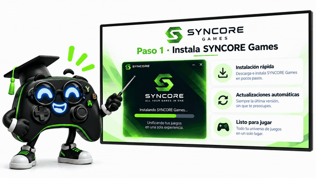

# 🎮 SYNCORE Games

**Organiza tus juegos. Protege tus partidas. Juega con mando.**

  

**SYNCORE Games** es el nombre público del proyecto. La aplicación se llama **SYNCORE** y está diseñada para Windows.

[**⬇️ DESCARGAR ÚLTIMA VERSIÓN ESTABLE / DOWNLOAD LATEST**](https://github.com/IMC93Labs/Syncore-Releases/releases/latest) · [Funciones / Features](docs/guides/features.md) · [Guía visual / Visual guide](docs/guides/visual-documentation.md) · [Ayuda / Support](SUPPORT.md)

### 🎬 Descubre SYNCORE Games / Discover SYNCORE Games

[**▶ Ver el vídeo promocional con música / Watch the promo video**](docs/media/current/SYNCORE_Games_profesor_mando_sin_pata.mp4)

*Ilustración promocional del mando profesor; la interfaz representada es conceptual, no una captura literal de SYNCORE. / Illustrated controller-teacher promo; depicted UI is conceptual, not an actual screenshot.*

### 🕹️ La aplicación real / The real application

[**🖼️ Ver capturas reales / See genuine screenshots**](docs/guides/visual-documentation.md)

**Idioma / Language:** [Español](#español) · [English](#english)

---

## Español

### Tus juegos, a tu manera

SYNCORE combina una **biblioteca de juegos para PC**, un **Modo Consola manejable con mando** y herramientas de **protección y sincronización de partidas**. Puedes organizar tus juegos y entrar en una interfaz pensada para jugar desde el sofá, sin sustituir Windows ni instalar otro sistema operativo.

### Lo que puedes hacer

| Herramienta | Para qué sirve |
|---|---|
| 🎮 **Biblioteca de juegos** | Añadir y ejecutar juegos, buscar, ordenar, filtrar, marcar favoritos y personalizar portadas y fondos. |
| 🖥️ **Modo PC** | Gestionar la biblioteca, las fichas de juegos y sus opciones con teclado y ratón. |
| 🕹️ **Modo Consola** | Explorar y ejecutar juegos con una interfaz a pantalla completa adaptada al mando. |
| 🎛️ **Control Center** | Acceder a ajustes rápidos, opciones de audio y rendimiento, y controles del OSD disponibles. |
| 💾 **Protección de partidas** | Configurar carpetas, mantener respaldos e historial y recuperar versiones de guardados. |
| ☁️ **Google Drive opcional** | Sincronizar y recuperar las partidas configuradas; comprobar versiones y resolver divergencias antes de sustituir datos. |
| 📊 **Monitorización / OSD** | Consultar sensores disponibles de CPU, GPU y memoria; medir FPS y frametime mediante PresentMon en juegos compatibles. |
| 🔄 **Actualizaciones** | Comprobar nuevas versiones estables e instalarlas con confirmación, conservando datos compatibles. |

### Descarga e instalación

1. Abre [**la versión oficial más reciente**](https://github.com/IMC93Labs/Syncore-Releases/releases/latest).
2. Descarga el archivo **`SynCore-Setup-vX.Y.Z.exe`** de *Assets*. No necesitas descargar `update.json` ni el archivo de procedencia para instalar.
3. Ejecútalo en **Windows 10/11 x64** y revisa los componentes y permisos opcionales del instalador.
4. Abre SYNCORE y añade o configura tus juegos desde **Modo PC**. La sincronización con Google Drive es opcional.

**¿Ya lo tienes instalado?** SYNCORE permite pasar directamente desde versiones estables compatibles a la última mediante su actualizador, sin instalar todas las versiones intermedias. Haz una copia independiente de tus partidas importantes antes de actualizar.

### Seguridad y límites que conviene conocer

- **El instalador de SYNCORE no está firmado digitalmente.** Descarga únicamente de este repositorio, mantén las protecciones de Windows activadas y contrasta el SHA-256 publicado con el archivo descargado. [Verificar una descarga](docs/guides/quick-start.md).
- La protección de partidas requiere seleccionar **las carpetas correctas** y un volumen **NTFS** donde se utilicen enlaces de protección. Conserva también respaldos independientes.
- La nube requiere **tu propia configuración OAuth de Google Drive**. SYNCORE no distribuye cuentas ni credenciales.
- Las temperaturas, FPS y demás métricas dependen de sensores, permisos y juegos compatibles; si no hay datos fiables, no se inventan lecturas.
- **Todavía no están terminados** el asistente completo de añadir juegos con mando y el limitador dinámico de FPS. DLSS5/ReShade es experimental y de compatibilidad limitada; no se recomienda usarlo con juegos protegidos por antitrampas. [Consultar límites](docs/guides/features.md).

### Guías y comunidad

**[📘 Empezar](docs/guides/quick-start.md)** · **[🖼️ Pantallas reales](docs/guides/visual-documentation.md)** · **[🧩 Funciones y límites](docs/guides/features.md)** · **[💬 Preguntas y ayuda](SUPPORT.md)** · **[🐛 Informar de un error](https://github.com/IMC93Labs/Syncore-Releases/issues/new/choose)**

---

## English

### Your PC games, your way

SYNCORE is a **Windows game library and launcher** with a controller-friendly **Console Mode**, a **Control Center**, and tools for **game-save protection and recovery**. It runs on Windows; it does not replace your operating system.

### What's inside?

| Feature | What it does |
|---|---|
| 🎮 **Game library** | Add and launch games; search, sort, filter, mark favourites and customise artwork. |
| 🖥️ **PC Mode** | Manage the library and game settings with keyboard and mouse. |
| 🕹️ **Console Mode** | Browse and launch games from a full-screen, gamepad-oriented interface. |
| 🎛️ **Control Center** | Access quick settings, available audio and performance options, and OSD controls. |
| 💾 **Save protection** | Choose save folders, keep protected backups and history, and recover saved versions. |
| ☁️ **Optional Google Drive** | Synchronise configured game saves, compare versions and resolve conflicts before replacing data. |
| 📊 **Monitoring / OSD** | View available CPU/GPU/memory readings; PresentMon FPS and frametime on supported games. |
| 🔄 **Updates** | Find stable releases and update with confirmation while retaining compatible user data. |

### Download and install

1. Open the [**latest official release**](https://github.com/IMC93Labs/Syncore-Releases/releases/latest).
2. Under *Assets*, download **`SynCore-Setup-vX.Y.Z.exe`**. The update feed and provenance files are not required for a normal installation.
3. Install on **Windows 10/11 x64** and review the optional setup components and permissions.
4. Open SYNCORE and configure your games from **PC Mode**. Google Drive is optional.

**Already installed?** Compatible stable versions can upgrade directly using the built-in updater. Keep independent backups of valuable saves before upgrading.

### Safety and limitations

- **The SYNCORE installer is unsigned.** Use this official repository, keep Windows protections enabled and verify the published SHA-256. [Download verification guide](docs/guides/quick-start.md).
- Save protection needs the correct folders and **NTFS** where protective links are used. Keep independent backups.
- Cloud sync requires **your own Google Drive OAuth configuration**; no account or credentials are supplied.
- Hardware readings and frame metrics depend on supported sensors, permissions and games; unavailable data is never fabricated.
- The gamepad-native **Add game** wizard and dynamic FPS limiter are **not finished**. DLSS5/ReShade integrations are experimental and limited; avoid anti-cheat-protected games. [Full feature matrix](docs/guides/features.md).

### Guides and community

**[📘 Quick start](docs/guides/quick-start.md)** · **[🖼️ Genuine screenshots](docs/guides/visual-documentation.md)** · **[🧩 Features & limitations](docs/guides/features.md)** · **[💬 Support](SUPPORT.md)** · **[🐛 Report an issue](https://github.com/IMC93Labs/Syncore-Releases/issues/new/choose)**

---

**IMC93Labs · SYNCORE Games** · Public releases, documentation and support. The application source code is not published in this repository. Previous Game Sync Hub releases remain in the historical archive. Promotional illustrations, when used, are distinguished from genuine application screenshots.
