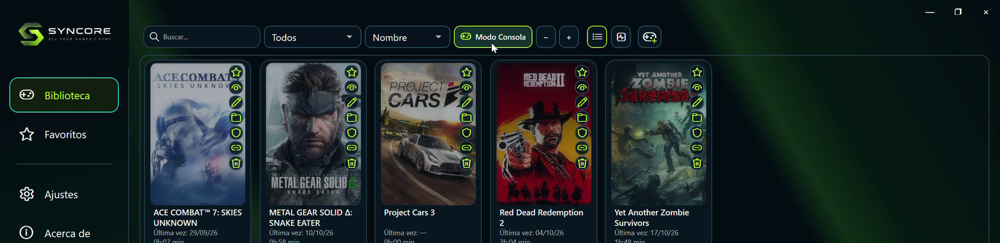
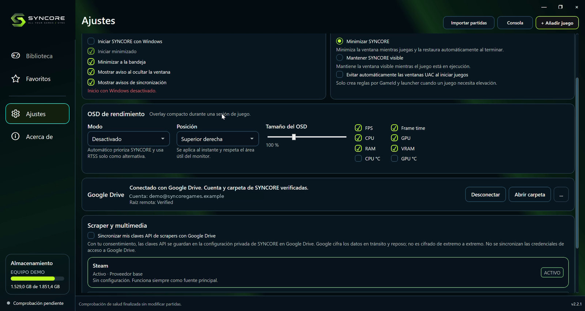
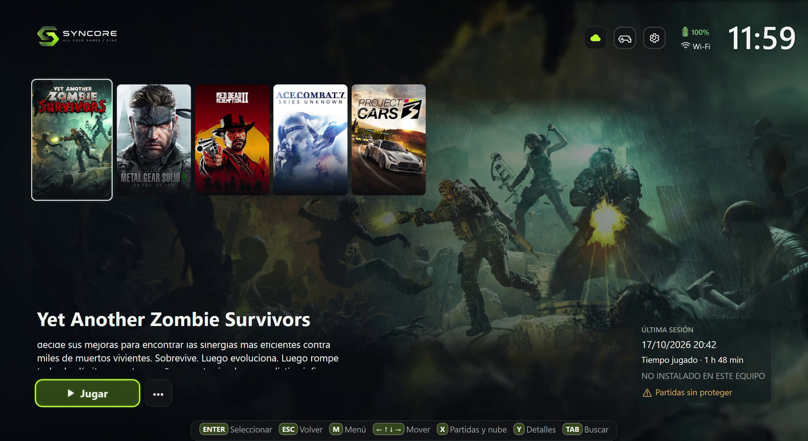
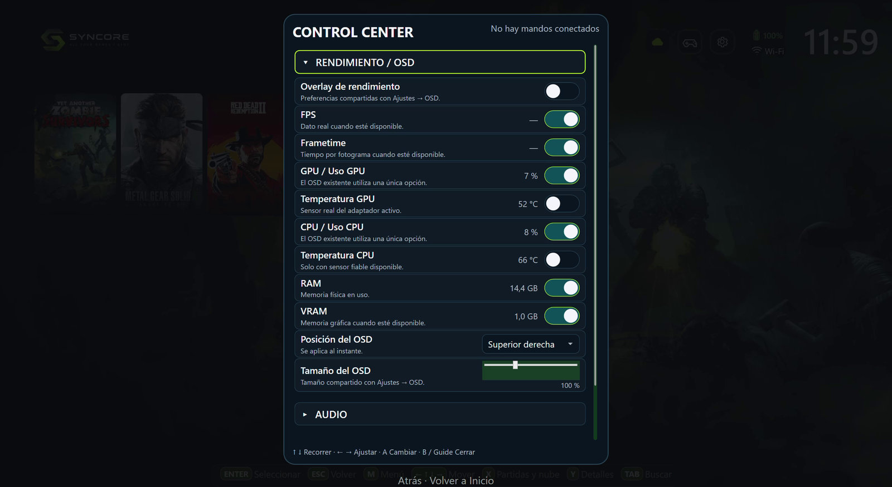
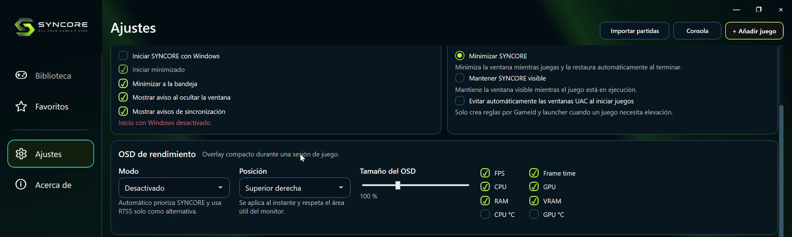
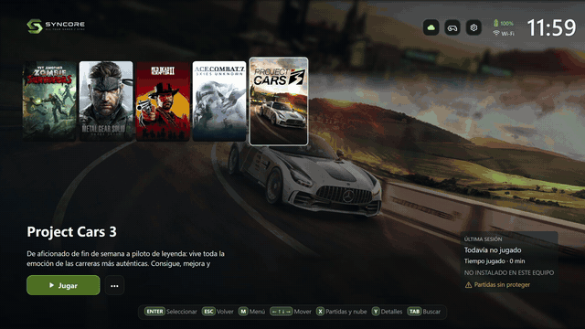

# 🖼️ Guía visual / Visual guide

> **SYNCORE Games** · [Inicio / Home](../../README.md) · [Descarga / Download](https://github.com/IMC93Labs/Syncore-Releases/releases/latest) · [Primeros pasos / Quick start](quick-start.md) · [Funciones / Features](features.md) · [Ayuda / Support](../../SUPPORT.md)

**Idioma / Language:** [Español](#español) · [English](#english)

---

## Español

### Capturas auténticas de referencia (grabadas en SYNCORE 2.2.1)

Estas imágenes muestran la aplicación real grabada en **2.2.1** y están anonimizadas. La estable actual es **2.2.2**: su interfaz y Mini Arcade pueden diferir, por lo que estas imágenes no se presentan como capturas nuevas de 2.2.2. [Novedades de 2.2.2](../releases/v2.2.2.md).

#### Biblioteca · Modo PC

La biblioteca reúne carátulas, búsqueda, filtros, favoritos y acceso al Modo Consola.

#### Google Drive y ajustes

La cuenta y el equipo de la imagen son datos de demostración; no representan una cuenta personal.

#### Modo Consola

#### Control Center

#### Ajustes y OSD

#### Demostración animada de la aplicación

La animación procede de una grabación de SYNCORE. El GIF promocional del mando que aparece al inicio del README es una ilustración conceptual, no una captura literal de la aplicación. [Ver el vídeo promocional con música](../media/current/SYNCORE_Games_profesor_mando_sin_pata.mp4).

**Archivo histórico:** las capturas y GIF que permanecen directamente en [`docs/media/`](../media/) corresponden a Game Sync Hub 1.x; no representan la versión SYNCORE 2.2.2. Los medios actuales de SYNCORE están en [`docs/media/current/`](../media/current/).

[Funciones reales y sus límites](features.md) · [Primeros pasos](quick-start.md)

---

## English

### Genuine reference screenshots (recorded in SYNCORE 2.2.1)

These images show the actual **2.2.1** application and were anonymized. The current stable version is **2.2.2**; its UI and Mini Arcade may differ, so these are not presented as new 2.2.2 screenshots. [What's new in 2.2.2](../releases/v2.2.2.md).

#### Library · PC Mode

The library brings together cover art, search, filters, favourites and entry to Console Mode.

#### Google Drive and settings

The account and computer shown are demonstration data; they do not represent a personal account.

#### Console Mode

#### Control Center

#### Settings and OSD

#### Animated application demonstration

This animation comes from a SYNCORE recording. The controller GIF at the top of the README is conceptual promotional artwork, not a literal screenshot of the application. [Watch the music-backed promo video](../media/current/SYNCORE_Games_profesor_mando_sin_pata.mp4).

**Historical archive:** screenshots and GIFs kept directly in [`docs/media/`](../media/) belong to Game Sync Hub 1.x; they do not depict SYNCORE 2.2.2. Current SYNCORE media is stored in [`docs/media/current/`](../media/current/).

[Real features and limitations](features.md) · [Quick start](quick-start.md)

---

SYNCORE Games · IMC93Labs · [Inicio / Home](../../README.md)
